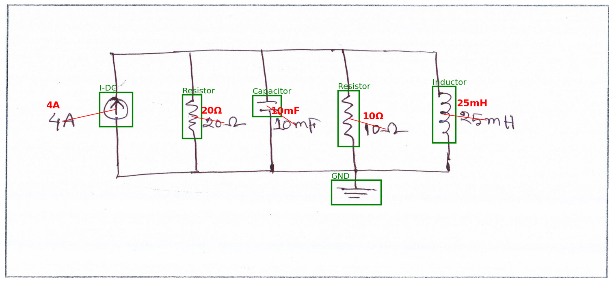

# Handwritten circuit diagram recognition

A computer vision pipeline that reads hand-drawn electrical circuits: it finds every component, says what it is, reads the handwritten value next to it and attaches that value to the right component.

Built on the [Digitize-HCD dataset](https://data.mendeley.com/datasets/rngcz5wtv8/1) (1,277 scanned hand-drawn circuits, 17 component classes), it combines one YOLO11 detector for components and text, a fine-tuned TrOCR model and a unit-aware matching step.



## Results (held-out test set)

| Stage | Result |
|---|---|
| **Component detection** | mAP50 **0.989**, mAP50-95 **0.814**; 1,871 of 1,894 components (98.8 %) found with the correct class |
| **Text detection** | AP50 **0.994**; 1,188 of 1,194 handwritten values found |
| **Value reading** | **90.3 %** of values found, read exactly and attached to a compatible component |

All decisions (model size, image size, confidence thresholds, best epoch) are made on the validation split. The test split is evaluated once, at the end; its scores are almost identical to validation.

## How it works

The notebook follows three steps: **detect** the components and the text, **read** the text, and **match** each value to a component.

### 1. Detection: components and text, one model

One YOLO11m finds the 17 component classes and the handwritten values (an 18th class, `text`) in a single pass.

- **Data:** component boxes (COCO format) and text boxes are joined per image. Boxes are clipped to the image; component boxes with a side under 5 px and text boxes of 1 px or less are dropped.
- **Split:** 80 / 10 / 10 by image (1,021 / 128 / 128), so no drawing appears in two splits. It is stratified on each image's rarest component class, so every class appears in all three. The reader and the matching reuse the same split.
- **Model:** YOLO11m pretrained on COCO. A one-stage detector fits the problem (one class per box, many small objects, no masks needed), transfer learning suits a ~1k-image dataset, and the medium size keeps fine details such as arrow direction or the bar of a Zener diode. Detecting text in the same model means one training and one pass per image.
- **Training:** `imgsz=1024` (at 640 px many symbols and texts shrink to a few pixels), up to 100 epochs with patience 20, batch 4. Horizontal flips are off because mirrored symbols and handwriting never occur; a ±5° rotation imitates tilted scans. Training stopped at epoch 97 (best epoch 77), in 1.95 h on a free Kaggle T4.
- **Two thresholds**, both chosen on validation and reused unchanged on test: components at **0.71** (best mean F1 over the 17 component classes) and text at **0.59** (best text F1).
- **Reporting:** component mAP is the mean over the 17 component classes only, so the text class does not inflate it; text gets its own AP.

| Split | Images | Components | mAP50 | mAP50-95 | Precision | Recall |
|---|---|---|---|---|---|---|
| Validation | 128 | 1,914 | 0.985 | 0.802 | 0.984 | 0.987 |
| **Test** | 128 | 1,894 | **0.989** | **0.814** | 0.984 | 0.989 |

**Where it fails (29 component errors on test):**

| Error type | Count | Main cases |
|---|---|---|
| Missed | 14 | Zener Diode (3), Wire Crossover (2), GND (2), one each of 7 other classes |
| Wrong class | 9 | Look-alike pairs: V-DC→I-DC (2), BJT PNP→NPN, MOSFET P→N, MOSFET P→BJT PNP, V-AC→I-AC, Diode→Zener, Inductor↔Resistor (1 each way) |
| False alarm | 6 | GND (3), Wire Crossover (2), Zener Diode (1) |

Wrong classes are pairs that differ by one small detail (arrow direction, a bar, the sign inside a source). Misses and false alarms are mostly small symbols. No component is ever confused with text. The gap between mAP50 (~0.99) and mAP50-95 (0.81) means the components are found but box edges are less exact, which is expected for hand-drawn symbols with no well-defined edge; the lowest mAP50-95 values are V-DC (one port) 0.73, GND 0.74 and Diode 0.74.

### 2. Reading: fine-tuned TrOCR

`microsoft/trocr-base-handwritten`, fine-tuned for 3 epochs on ~9,500 crops of the ground-truth text boxes; the best epoch on validation (epoch 3) is kept. Training on true boxes keeps reading errors separate from detection errors. Out of the box it reads only about 11 % of validation values exactly, mostly because it misreads `μ` and `Ω`; after fine-tuning, 91.4 % on test.

### 3. Matching and full pipeline

The unit restricts which classes a value can belong to (`Ω` → resistor, `F` → capacitor, `H` → inductor, `Hz` → AC sources, `V` → voltage sources, `A` → current sources), then the text goes to the nearest allowed component. A value without a unit inherits it from the class (`1k` next to a resistor → `1kΩ`).

| Stage | Validation | Test |
|---|---|---|
| Text detection, AP50 / AP50-95 | 0.995 / 0.776 | 0.994 / 0.785 |
| Reader on true text boxes, exact match | 0.923 | 0.914 |
| Reader on true text boxes, character error rate | 0.036 | 0.040 |
| End to end: text found | 0.995 | 0.996 |
| End to end: found and read exactly | 0.921 | 0.905 |
| End to end: found, read and attached | 0.921 | 0.903 |

Reading is the bottleneck: almost every value is found, and most of the remaining loss is TrOCR. The dataset has no text-to-component links, so matching is checked indirectly: on true boxes, distance alone already picks a unit-compatible component 94.9 % of the time, and the unit rule changes the choice in the remaining 5.1 %.

## Quick start

Download `circuit-reader-outputs.zip` from the [Releases](../../releases) page and unzip it, then:

```python
from ultralytics import YOLO

CONF, TEXT_CONF = 0.71, 0.59          # thresholds chosen on validation
model = YOLO("detector_yolo11m_1024/weights/best.pt")
r = model.predict("path/to/your_circuit.png", imgsz=1024, conf=min(CONF, TEXT_CONF))[0]

for cls, conf, box in zip(r.boxes.cls, r.boxes.conf, r.boxes.xyxy):
    name = model.names[int(cls)]
    if conf >= (TEXT_CONF if name == "text" else CONF):
        print(name, f"{float(conf):.2f}", box.round().tolist())
```

These thresholds suit clean scans; on photos a lower value such as 0.25 finds more components (see [Limitations](#limitations)). Reading the values needs the fine-tuned TrOCR, which the notebook trains.

## Reproduce

The whole pipeline is one self-contained notebook, [`circuit-reader.ipynb`](circuit-reader.ipynb): it trains everything from the dataset, with nothing from earlier runs.

1. On [Kaggle](https://www.kaggle.com/), import the notebook and add the [Digitize-HCD dataset](https://www.kaggle.com/datasets/diegofogued/digitize-hcd) as input.
2. Set Accelerator to **GPU T4** and Internet to **On** (to install packages and download the pretrained YOLO11m and TrOCR weights).
3. For the final run, set `RUN_TEST = True` in the first code cell. The test set is evaluated once, after every choice has been made on validation.
4. Use **Save Version → Save & Run All**. A full run takes about 2.5 h and produces `circuit-reader-outputs.zip` in the Output tab.

The published notebook is on Kaggle: [`circuit-reader`](https://www.kaggle.com/code/diegofogued/circuit-reader).

## Repository layout

```
circuit-reader.ipynb    # full pipeline: data, split, detector, TrOCR, matching, evaluation
results/
  figures/              # training curves, PR / F1 curves, confusion matrices, example output
  *.csv, *.json         # per-class metrics, training log, split, summaries
```

The fine-tuned TrOCR model (~1.3 GB) is not published; the notebook retrains it in ~22 min.

## Limitations

- **Scans only.** Everything is evaluated on clean scans from one dataset. On a hand-drawn phone photo the tuned threshold was too strict and some components only appeared at 0.25.
- **Split by image, not by writer.** The dataset has no writer id, so the same handwriting may appear in train and test; scores on new writers may be lower.
- **One configuration.** One model size, one image size and one seed, with no architecture comparison.
- **Value reading** only knows the dataset's labelling style (no designators like `R1`). Remaining errors are unit prefixes (m / M / μ), repeated digits (`77V` for `7V`) and formula-style values. Matching is not verified per instance.

## Next steps

- Size and resolution sweep (YOLO11s / m / l, 640 vs 1024 px) to back the model choice with numbers.
- Photo-style augmentation (blur, lighting, perspective) or a few labelled photos to handle real-world pictures.
- Tiled inference (SAHI) for the small symbols that are still missed, such as Zener diodes and wire crossovers.
- Class-specific crops or higher resolution to separate look-alike pairs (PNP/NPN, P/N MOSFET, voltage/current sources).
- Export the full pipeline to a structured netlist (components, values, connections).

## Licences

- Dataset: CC BY 4.0 — Ahmed et al., [*Data in Brief*](https://www.ncbi.nlm.nih.gov/pmc/articles/PMC11808513/).
- Ultralytics YOLO: AGPL-3.0.
- TrOCR: see the [`microsoft/trocr-base-handwritten`](https://huggingface.co/microsoft/trocr-base-handwritten) model card.
