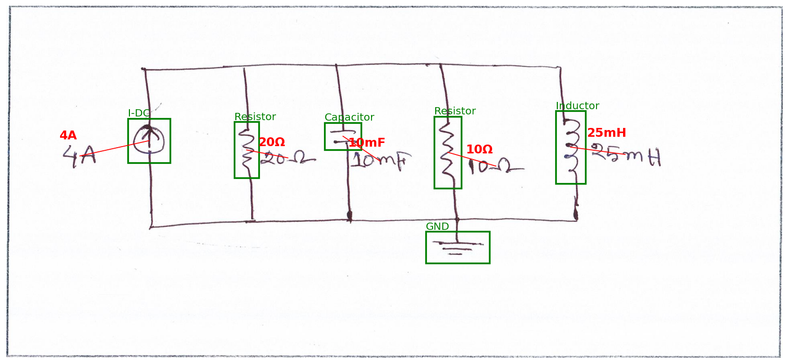

# Handwritten circuit diagram recognition

Reads hand-drawn electrical circuits: finds every component, reads the handwritten value next to it and attaches that value to the right component.

[](https://www.kaggle.com/code/diegofogued/circuit-reader)



## Results (held-out test set)

| Stage | Result |
|---|---|
| Component detection (17 classes) | mAP50 **0.989**, mAP50-95 **0.814**; mean per-class recall **0.989** |
| Text detection | AP50 **0.994**; **99.6 %** of the 1,194 values found |
| Value reading (detect + read + attach) | **90.3 %** of values read exactly and attached to a compatible component |

Every choice (thresholds, best epoch) is made on validation; the test set is evaluated once.

## How it works

1. **Detect:** one YOLO11m at 1024 px finds the 17 component classes and the handwritten text (an 18th class) in a single pass.
2. **Read:** TrOCR (`microsoft/trocr-base-handwritten`), fine-tuned on the dataset's text crops. Fine-tuning brings exact match on ground-truth crops to 91.4 % (test); the off-the-shelf model reads almost none of them (~11 % on validation, printed in section 2.1 of the notebook).
3. **Match:** the unit limits which components a value can belong to (`Ω` → resistor, `F` → capacitor, `V` → voltage source…), then the value goes to the nearest allowed one.

Data: [Digitize-HCD](https://data.mendeley.com/datasets/rngcz5wtv8/1), 1,277 scanned circuits, split 80/10/10 by image. Detailed metrics are in [`results/`](results/).

## Quick start

Download `circuit-reader-outputs.zip` from [Releases](../../releases), unzip it, then:

```python
from ultralytics import YOLO

model = YOLO("detector_yolo11m_1024/weights/best.pt")
model.predict("your_circuit.png", imgsz=1024, conf=0.59, save=True)
```

Tuned thresholds: 0.71 for components, 0.59 for text (see [`results/detection_summary.json`](results/detection_summary.json)). On photos rather than scans, try 0.25.

### Full pipeline (detect, read, match)

`circuit_reader.py` wraps the whole pipeline. It needs the detector from the Release **and** the fine-tuned TrOCR reader. The reader is **not** in the Release (about 1.3 GB): produce it by running the notebook, which saves it in the folder `trocr_values`.

```python
from circuit_reader import CircuitReader

reader = CircuitReader("detector_yolo11m_1024/weights/best.pt", "trocr_values")  # comp_conf=0.71, text_conf=0.59
texts, items = reader.read("your_circuit.png")
for item in items:  # keys: text, text_box, cls, comp_box, value
    print(item["text"], "->", item["cls"], item["value"])
```

Or from the command line (prints JSON):

```bash
python circuit_reader.py your_circuit.png --detector detector_yolo11m_1024/weights/best.pt --reader trocr_values
```

Install the dependencies with `pip install -r requirements.txt`. [`results/pip_freeze.txt`](results/pip_freeze.txt) is the exact Kaggle environment.

## Reproduce

Run [`circuit-reader.ipynb`](circuit-reader.ipynb) on [Kaggle](https://www.kaggle.com/code/diegofogued/circuit-reader) with the [Digitize-HCD dataset](https://www.kaggle.com/datasets/diegofogued/digitize-hcd), a T4 GPU and Internet on. It fine-tunes the pretrained YOLO11m (COCO) and TrOCR models end to end on the dataset in about 2.5 h. Set `RUN_TEST = True` only for the final run.

## Development

```bash
pip install -r requirements-dev.txt
pytest
ruff check .
mypy circuit_reader.py
```

## Limitations

- Evaluated on clean scans only; phone photos need a lower threshold.
- Split by image, not by writer, so scores on new handwriting may be lower.
- The reader only knows the dataset's labelling style (no designators like `R1`).

## Licences

This repository: AGPL-3.0 (see [LICENSE](LICENSE)) · Dataset: CC BY 4.0 ([Ahmed et al., *Data in Brief*](https://www.ncbi.nlm.nih.gov/pmc/articles/PMC11808513/)) · Ultralytics YOLO: AGPL-3.0 · TrOCR: see the [model card](https://huggingface.co/microsoft/trocr-base-handwritten).
